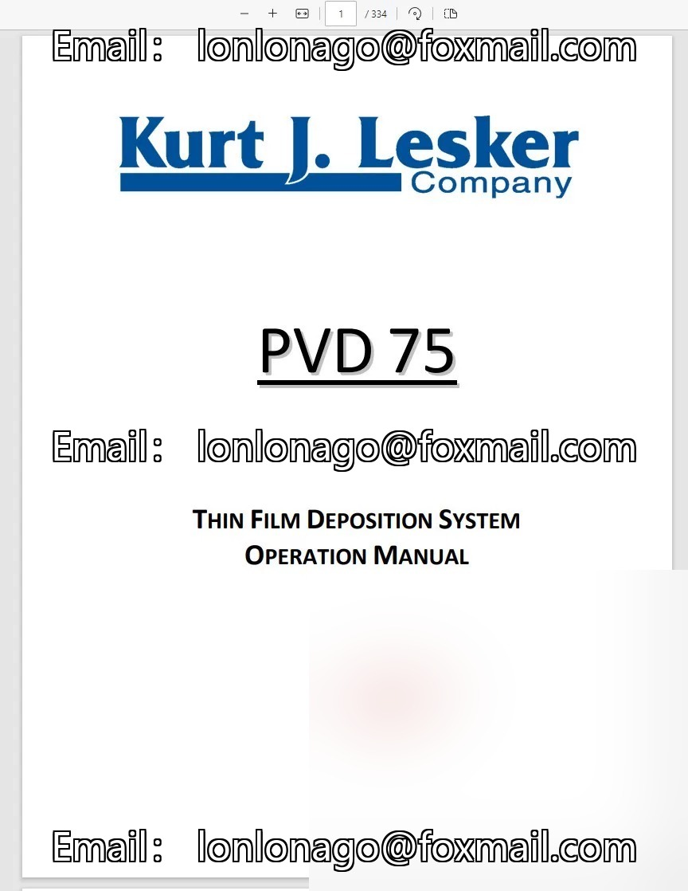
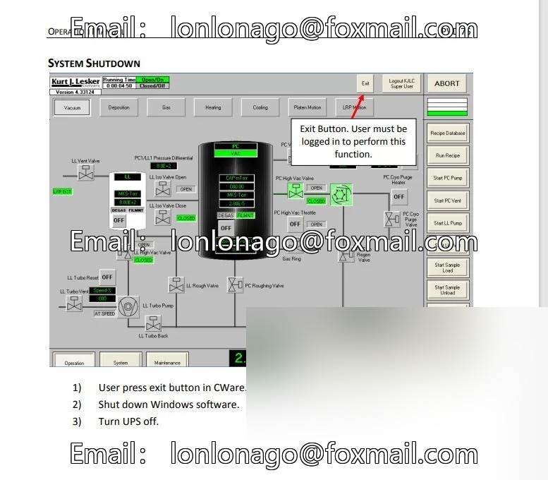
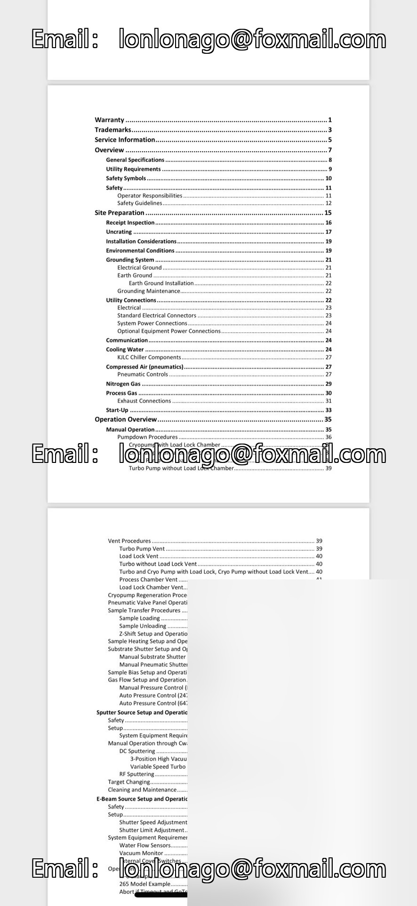
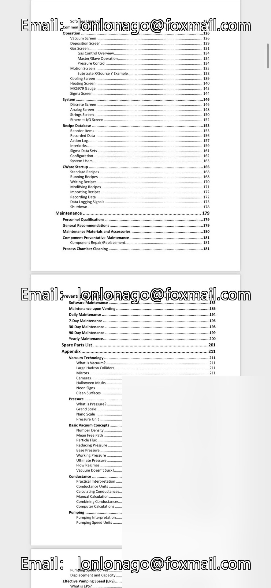
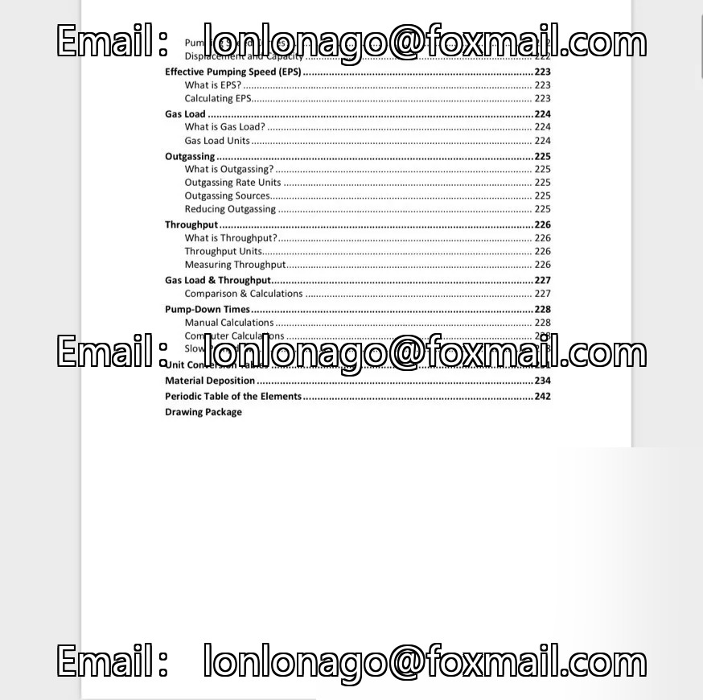

# Semiconductor thin film deposition PVD75 operation manual

## Body

Semiconductor film deposition PVD 75 operation manual

Take a photo and immediately send the electronic original file! The following images are screenshots of the file directory. Confirm before placing the order! Due to the replicability of electronic filing materials, So after purchase, returns are not allowed! Thanks for understanding!

The manual covers the operation of semiconductor thin film deposition PVD75 and includes a file directory screenshot along with system status, operation interfaces and related procedures.

<!-- AI_ENRICHED -->

## Images

## Payment

Here is a pay link on Stripe ( https://buy.stripe.com/3cs8yP7sY87d0vu9AB ). Please contact me lonlonago@foxmail.com after funding $89, and I will send you a complete data files , thank you!

